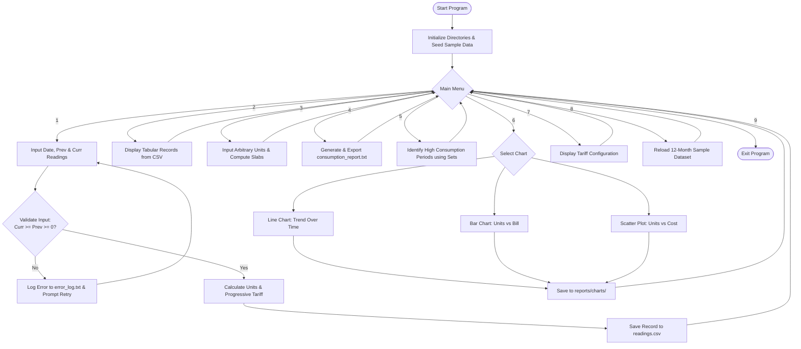

# Smart Electricity Usage and Bill Analyzer

[](file:///c:/programming/aswan%20minor%20s3/PROGRAMMING%20FOUNDATIONS%20FOR%20ENGINEERS.docx)
[](#)
[](#)
[](#)

A Python-based engineering project designed to monitor, calculate, and analyze household electricity consumption. The primary objective is to help consumers understand energy usage patterns, accurately estimate electricity bills using configurable progressive tariffs, and detect high-consumption periods to encourage energy conservation.

---

## 📋 Table of Contents
1. [Project Overview & Objectives](#-project-overview--objectives)
2. [Syllabus & Course Outcome (CO) Mapping](#-syllabus--course-outcome-co-mapping)
3. [System Architecture & Modular Structure](#-system-architecture--modular-structure)
4. [Engineering Mathematics & Tariff Model](#-engineering-mathematics--tariff-model)
5. [Algorithm, Flowchart & Pseudo-Code](#-algorithm-flowchart--pseudo-code)
6. [Data Structures Implementation](#-data-structures-implementation)
7. [File Handling & Logging](#-file-handling--logging)
8. [Matplotlib Visualizations](#-matplotlib-visualizations)
9. [Installation & Execution Guide](#-installation--execution-guide)
10. [Git & GitHub Version Control Guide](#-git--github-version-control-guide)
11. [Future Scope (IoT Energy Meter Integration)](#-future-scope-iot-energy-meter-integration)

---

## 🌟 Project Overview & Objectives

Household electricity management is often reactive—consumers receive monthly bills without understanding which factors or periods contributed to peak charges. 

**The Smart Electricity Usage and Bill Analyzer** provides an automated, cost-effective computational framework to:
* **Monitor Consumption:** Record and track electricity meter readings (in kWh) across multiple billing cycles.
* **Estimate Charges:** Compute bills accurately based on a multi-tiered progressive tariff model, fixed meter charges, and regulatory electricity tax.
* **Identify Peak Periods:** Automatically flag billing cycles exceeding defined engineering consumption thresholds.
* **Visualize Patterns:** Generate publication-grade Line Charts, Bar Charts, and Scatter Plots using Matplotlib.
* **Persist & Document:** Maintain persistent CSV records, timestamped error logs, and detailed engineering consumption reports.

---

## 🎯 Syllabus & Course Outcome (CO) Mapping

This project strictly implements every syllabus requirement of **Programming Foundations for Engineers (Course Code: 25MNCST309)**:

| Unit & Title | Syllabus Topics Covered | Project Implementation |
| :--- | :--- | :--- |
| **Unit 1: Computational Thinking & Python Fundamentals** | Variables, data types, arithmetic operators, I/O statements, conditional statements (`if-elif-else`), iterative loops (`while`, `for`), exception handling (`try-except`). | Input validation loops, reading difference checks ($Curr \ge Prev$), safe numeric and date parsing, interactive CLI loop in [`main.py`](file:///c:/programming/aswan%20minor%20s3/main.py). |
| **Unit 2: Functions, Modular Programming & Engineering Computation** | User-defined functions, parameters, return values, variable scope, modular design, standard Python libraries (`csv`, `datetime`, `math`, `os`, `sys`). | Separation of responsibilities across [`config.py`](file:///c:/programming/aswan%20minor%20s3/config.py), [`tariff.py`](file:///c:/programming/aswan%20minor%20s3/tariff.py), [`data_manager.py`](file:///c:/programming/aswan%20minor%20s3/data_manager.py), [`analytics.py`](file:///c:/programming/aswan%20minor%20s3/analytics.py), and [`visualization.py`](file:///c:/programming/aswan%20minor%20s3/visualization.py). |
| **Unit 3: Data Structures and File Handling** | Lists, Tuples, Dictionaries, Sets. Manipulation of measurement data, file handling (CSV and text files), logs, and summary reports. | Meter records stored as dictionaries inside lists; tariff slabs as immutable tuples; peak dates as unique sets with set operations; CSV read/write and text report/log generation. |
| **Unit 4: Data Visualization, Version Control & PBL Mini Project** | Data visualization with Matplotlib (line charts, bar charts, scatter plots). Report generation, Git/GitHub repository management, version control, and commit practices. | 3 distinct Matplotlib charts, report export, comprehensive documentation, and Git version control setup. |

---

## 🏗️ System Architecture & Modular Structure

```
aswan minor s3/
│
├── config.py                 # System configuration, tariff slabs, directories, thresholds
├── tariff.py                 # Progressive tariff calculation engine
├── data_manager.py           # CSV storage, error logging, and text report generation
├── analytics.py              # Statistical computing with Lists, Tuples, Dicts, and Sets
├── visualization.py          # Matplotlib chart rendering (Line, Bar, Scatter)
├── main.py                   # User interface and main CLI execution flow
│
├── data/
│   └── readings.csv          # Persistent CSV database of meter readings
├── logs/
│   └── error_log.txt         # Timestamped error and exception logs
└── reports/
    ├── consumption_report.txt# Auto-generated engineering analysis report
    └── charts/
        ├── line_chart_trend.png
        ├── bar_chart_comparison.png
        └── scatter_plot_cost_analysis.png
```

---

## ⚡ Engineering Mathematics & Tariff Model

### 1. Units Consumed Calculation
Given previous meter reading $R_{prev}$ and current reading $R_{curr}$ (in kWh):
$$\text{Units} = R_{curr} - R_{prev} \quad (\text{Constraint: } R_{curr} \ge R_{prev} \ge 0)$$

### 2. Tiered (Progressive Slab) Tariff Structure
To incentivize energy conservation, tariffs are structured into progressive consumption tiers:

$$\text{Energy Charges} = \sum_{k=1}^{n} (\text{Units in Slab}_k \times \text{Rate}_k)$$

| Slab Tier | Range (kWh) | Rate per Unit (₹) | Slab Capacity |
| :---: | :---: | :---: | :---: |
| **Slab 1** | 0 – 100 | ₹ 3.00 | 100 |
| **Slab 2** | 101 – 300 | ₹ 4.50 | 200 |
| **Slab 3** | 301 – 500 | ₹ 6.50 | 200 |
| **Slab 4** | > 500 | ₹ 8.00 | Unlimited |

### 3. Total Bill Computation
$$\text{Subtotal} = \text{Energy Charges} + \text{Fixed Charge} \quad (\text{Fixed Charge} = ₹50.00)$$
$$\text{Tax Amount} = \text{Subtotal} \times \text{Tax Rate} \quad (\text{Tax Rate} = 5\%)$$
$$\text{Total Bill Amount} = \text{Subtotal} + \text{Tax Amount}$$

---

## 🔄 Algorithm, Flowchart & Pseudo-Code

### Flowchart (Mermaid)


### Pseudo-Code
```text
BEGIN SmartElectricityAnalyzer
    INITIALIZE directories (data, logs, reports, charts)
    IF readings.csv DOES NOT EXIST THEN
        CALL seed_sample_data()
    END IF

    WHILE true DO
        DISPLAY main_menu
        READ user_choice
        
        MATCH user_choice:
            CASE 1:
                PROMPT date, prev_reading, curr_reading
                TRY:
                    VALIDATE numeric and curr_reading >= prev_reading
                    units = curr_reading - prev_reading
                    bill_info = calculate_bill(units)
                    status = (units >= THRESHOLD) ? "High Usage" : "Normal"
                    APPEND record TO readings.csv
                CATCH ValueError AS error:
                    CALL log_error(error)
                    PRINT "Validation Error"
            CASE 2:
                readings = CALL load_readings()
                DISPLAY readings in table
            CASE 3:
                PROMPT units
                DISPLAY calculate_bill(units)
            CASE 4:
                readings = CALL load_readings()
                stats, summary = CALL compute_statistics(readings)
                high_set = CALL identify_high_consumption_periods(readings)
                CALL generate_consumption_report(readings, stats, high_set)
            CASE 5:
                CALL analyze_high_consumption()
            CASE 6:
                CALL plot_visualizations()
            CASE 7:
                DISPLAY current_tariff_slabs
            CASE 8:
                CALL seed_sample_data(overwrite=True)
            CASE 9:
                EXIT PROGRAM
    END WHILE
END
```

---

## 🗃️ Data Structures Implementation

In compliance with **Unit 3**, the project explicitly demonstrates all fundamental Python data structures:

1. **Lists:**
   * Dynamic collection of historical records: `readings = [record_1, record_2, ...]`.
   * Extracted numerical vectors for calculation: `units_list = [r['units'] for r in readings]`.
2. **Tuples:**
   * Immutable definitions of tiered tariff brackets: `(min_units, max_units, rate_per_unit)`.
   * Immutable numerical summary: `summary_tuple = (total_units, total_cost, avg_units)`.
3. **Dictionaries:**
   * Comprehensive representation of individual meter records:
     `{'id': 1, 'date': '2025-01-31', 'prev_reading': 1000.0, 'curr_reading': 1180.0, 'units': 180.0, 'bill_amount': 745.50, 'status': 'Normal'}`.
   * Granular tariff bill receipt containing tier breakdowns and taxes.
4. **Sets:**
   * High-consumption tracking: `high_usage_periods = {r['date'] for r in readings if r['units'] >= threshold}`.
   * Set algebra (Union, Intersection, Difference) to isolate anomalous summer peak periods.

---

## 📁 File Handling & Logging

* **CSV Data Storage (`data/readings.csv`):** Stores structured records using `csv.DictReader` and `csv.DictWriter`. Automatically creates header on initial write.
* **Error Logging (`logs/error_log.txt`):** Whenever an invalid reading, malformed date, or negative input occurs, a timestamped entry is written:
  ```text
  [2026-11-08 15:02:13] ERROR: Current reading (100.0) < Previous reading (150.0)
  ```
* **Comprehensive Engineering Report (`reports/consumption_report.txt`):** Automatically computes statistical totals, averages, maximums, and minimums and exports an formatted engineering document.

---

## 📊 Matplotlib Visualizations

The project generates 3 engineering charts saved under `reports/charts/`:

1. **Line Chart (`line_chart_trend.png`):**
   * Plots consumption timeline across 12 billing periods.
   * Features a dashed horizontal red line marking average consumption and an arrow annotation for the peak billing month.
2. **Bar Chart (`bar_chart_comparison.png`):**
   * Dual-axis comparative bar visualization displaying Energy Consumption (kWh) on the left Y-axis and Estimated Bill (₹) on the right Y-axis for each period.
3. **Scatter Plot (`scatter_plot_cost_analysis.png`):**
   * Explores the non-linear relationship between consumed units and total cost created by progressive tariff slabs.
   * Contrasts Normal consumption (blue circles) with High-Usage outliers (orange triangles) across the engineering threshold line.

---

## 🚀 Installation & Execution Guide

### 1. Prerequisites
* Python 3.10 or higher
* Matplotlib (`pip install matplotlib`)

### 2. Running the Application
From the project root directory, execute:
```bash
python main.py
```

### 3. Immediate Out-of-the-Box Testing
* When launched for the first time, the program automatically populates **12 months of realistic household meter readings** into `data/readings.csv`.
* Choose option **[4]** to immediately view the generated analysis report.
* Choose option **[6]** -> **[4]** to generate all 3 Matplotlib charts into `reports/charts/`.

---

## 🌿 Git & GitHub Version Control Guide

This project follows professional Git development practices as required by **Unit 4**:

### 1. Initialize Local Repository
```bash
git init
```

### 2. Stage and Commit Files
```bash
git add .
git commit -m "feat: initial release of Smart Electricity Usage and Bill Analyzer with modular tariff engine, CSV data manager, and Matplotlib charts"
```

### 3. Link to GitHub Remote Repository
```bash
git branch -M main
git remote add origin https://github.com/aswanayyappan/S3-MINOR-CSE.git
git push -u origin main
```

### Recommended Commit Practices:
* `feat:` for new features (e.g. `feat: add dual-axis bar chart for period comparison`).
* `fix:` for bug fixes (e.g. `fix: validate current reading against previous reading`).
* `docs:` for documentation updates (e.g. `docs: add syllabus mapping and flowchart`).

---

## 🔮 Future Scope (IoT Energy Meter Integration)

The project architecture is designed for seamless future extension into an **IoT-enabled Smart Energy Monitoring Platform**:
1. **Hardware Interfacing:** Connect an ESP32 microcontroller with a Non-Invasive AC Current Sensor (SCT-013 CT Sensor) and ZMPT101B Voltage Sensor.
2. **Real-Time Telemetry:** Stream live voltage, current, power factor, and accumulated kWh to this Python system via MQTT or REST API endpoints.
3. **Automated Anomaly Alerts:** Trigger push notifications or automated emails when instantaneous power exceeds sanctioned connected load.

---

## 👥 Course & Author Information
* **Course:** Programming Foundations for Engineers (25MNCST309)
* **Regulation:** 2025
* **Category:** Project-Based Learning (PBL)

